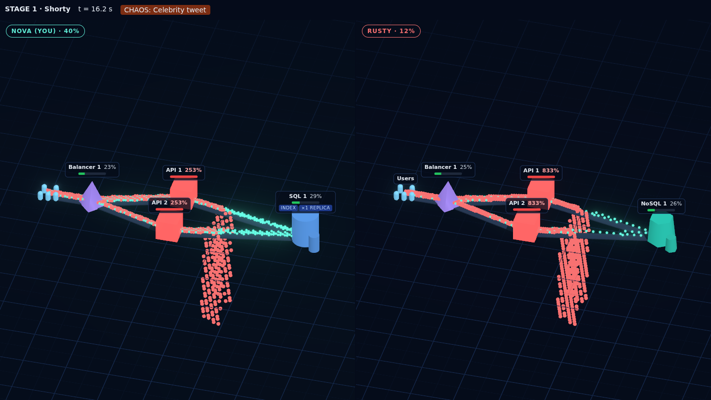
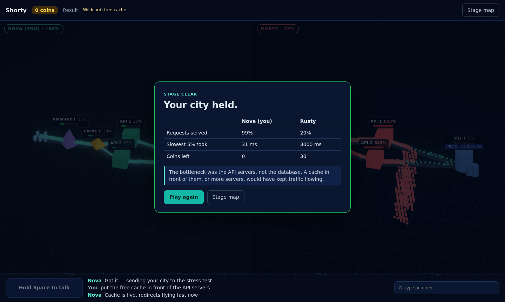

# Uptime City

**Talk to your hero to build a backend as a small 3D city. Then watch it survive the traffic, or burn.**

You say "round robin balancer, two large servers, SQL with an index and a replica" and your hero builds it: load balancers, API servers, caches, databases, queues, connected by roads. Then the stress test pours requests through the city as glowing orbs. Halfway through, a chaos card hits ("a celebrity just tweeted one of your links"), buildings turn red and requests fall off the map, and you get one shouted command to save it. A rival bot builds the same challenge on the other half of the screen.

It is a way to learn system design by doing the thing you can't do safely at work: watch a system break under load, and learn why.




Built for the Meta Global AI Developer Hackathon (Cerebral Valley, October-November 2026), Startups track, by CandiVision.

## What's inside

- **Campaign, 4 stages:** Shorty (a URL shortener), Chatter (a chat app where a server dies), Feed (a photo feed and a traffic surge) and the boss, Ticket Rush (a bot army, then the payment provider goes down).
- **11 classic system design interview problems:** Pastebox (paste sharing), Gatekeeper (an API rate limiter), Chirp (a Twitter-style timeline), Suggest (typeahead search), Seek (search), Nearby (places near you), StreamTube (video streaming), Driftbox (file sync), Crawlbot (a web crawler), Ridewave (ride hailing) and Feedline (a news feed).
- **A field guide of 15 topics:** load balancing, caching, CDNs, partitioning, consistent hashing, indexes, replication, SQL or NoSQL, the CAP trade-off, queues, object storage, proxies, push versus polling, how to approach a design and what makes a system good. It opens from the briefing, from the build list and from the lesson on the result screen.

The problems are the well-known ones that system design interviews keep coming back to; every brief, number, rival and explanation in this game is written from scratch.

## How to play

1. Pick your hero's class. Every class has the same total power; they differ in shape (Data Keeper, Edge Runner, Firefighter, Generalist).
2. Pick a stage and read the briefing. You have a coin budget.
3. Hold <kbd>Space</kbd> and talk. One sentence can build several buildings, add-ons and roads. If an order is ambiguous ("a cache" - in front of the servers or behind them?), your hero asks back, with a 3-second clock.
4. Say "submit". Traffic flows. When the chaos card hits, the test pauses: one shouted command, 8 seconds.
5. Beat the rival's requests served to clear the stage. The result screen tells you what broke and why.

No microphone? Type your orders in the box. The game also keeps working when the day's AI budget is used up: it switches to a low-power mode with typed orders and a scripted rival.

## Built during the hackathon

Every file in this repository was written during the event. Work started on 2026-10-26 21:34 EDT (2026-10-27 08:34 in Hanoi), after kickoff, once the organisers confirmed that building could begin from kickoff. The git history shows each step. Nothing was copied from earlier projects; third-party libraries are used as dependencies (React, three.js and react-three-fiber, Fastify, the OpenAI SDK as an API client, ws).

## Meta models

| What | Model | How |
|---|---|---|
| Your hero: turns what you say into building actions, asks back when unsure | **Muse Spark** (`muse-spark-1.3`, Meta Model API) | Tool calling with validated actions, several rounds per order |
| The rival bot: builds its own city in character, with a deliberate blind spot | **Muse Spark Open** (open weights, Baseten) | JSON build plans, checked by the same rules engine |
| Hearing you: push-to-talk | **Muse Voice Transcribe** (realtime WebSocket) | Keyword biasing for SQL, NoSQL, load balancer and other game words |
| Voices of the hero, the rival and the commentator | ElevenLabs | Meta has no speech output model |

Every action a model proposes goes through the same deterministic rules engine and traffic simulation (`packages/core`), so the score always comes from the simulation, never from a model's opinion.

## How it works

- `packages/core`: game rules, stages, classes and the flow simulation (10 ticks per second, caches with warm-up and hot keys, queues with backlogs, load balancers that do or don't route around dead servers). Pure TypeScript, shared by the browser and the server.
- `apps/server`: Fastify. Proxies every model call so keys never reach the browser: `/api/command` (Muse Spark agent), `/api/rival` (Muse Spark Open), `/ws/stt` (Muse Voice Transcribe), `/api/tts` (voices). Per-run caps and a daily budget for the public demo.
- `apps/web`: React + react-three-fiber. The 3D city, the game flow and push-to-talk.

## Run it locally

```bash
npm install
cp .env.example .env   # add META_API_KEY, BASETEN_API_KEY, ELEVENLABS_API_KEY
npm run dev:server     # http://localhost:8787
npm run dev:web        # http://localhost:5173
npm test               # core, server and web tests
```

`/?demo` plays a scripted match without any keys. Deploying: see [docs/DEPLOY.md](docs/DEPLOY.md).
